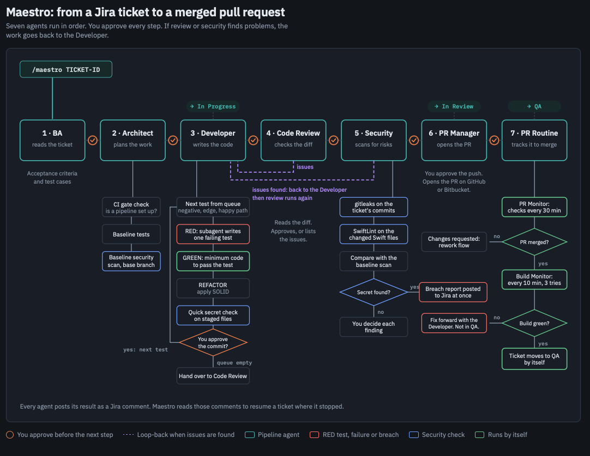

# Maestro

**An AI orchestrator that takes Jira tickets and runs the iOS development with TDD, all the way to a merged pull request, with YOU in control of every step.**


## What is Maestro?

Maestro assists you in developing iOS software through its entire lifecycle, with test-driven development (TDD) at its core. You give it a Jira ticket. Seven agents analyse the ticket, plan the work, write a failing test first (red), then make it pass (green), then refactor. They review the code, scan it for security problems, and push it to open a pull request. Maestro then follows the pull request through CI/CD feedback until it is merged and the build is green, and finally sets the ticket ready for QA. It also keeps track of the security and test coverage metrics.

Maestro also cares about token usage. Each agent runs on the model that fits its task: the strongest models for planning and coding, and lighter ones for simpler steps such as reviewing and opening pull requests.

> [!NOTE]
> **Human in the loop.** A human stays in control throughout. Today, Maestro asks for your approval at every step. In the future, as AI and Maestro prove they can deliver results you can trust, we plan to remove those gates gradually, to improve AI autonomy.

## What is it for?

Maestro automates the routine steps of an iOS ticket and keeps you in control of the decisions.

- **Less hand-off work.** One command carries a ticket from "To Do" to "QA". Jira columns and comments are updated for you.
- **Good habits by default.** Test-driven development, SOLID principles, a clear architecture guide, and a security scan are built in.
- **You stay in charge.** Maestro asks before it moves to the next agent, before every commit, and before every push.

> [!NOTE]
> Maestro is built for iOS projects (Swift, Xcode, Jira, and GitHub or Bitbucket). It runs on macOS.

## How it works



| # | Agent | What it does |
|---|-------|--------------|
| 1 | **BA** | Reads the ticket and writes acceptance criteria and test cases |
| 2 | **Architect** | Confirms the base branch, plans the work, runs a baseline security scan |
| 3 | **Developer** | Writes the code test-first (RED, GREEN, REFACTOR), one commit at a time |
| 4 | **Code Review** | Reads the diff, then approves it or lists the issues |
| 5 | **Security** | Scans the ticket's commits with gitleaks and SwiftLint and compares with the baseline |
| 6 | **PR Manager** | Pushes the branch and opens the pull request |
| 7 | **PR Routine** | Watches the pull request, checks the build after the merge, and moves the ticket to QA |

If Code Review or Security finds problems, the work goes back to the Developer, and both checks run again.

## Install

**Before you start:** have a local clone of each iOS repo you want to use with Maestro, and the access Maestro will ask for: your Jira account, your GitHub or Bitbucket account, and your Claude login (a paid Claude plan, or an Anthropic API key; see *Claude login* below). The installer sets up everything else.

```bash
git clone https://github.com/GuilhermeSol/Maestro
cd Maestro
./install.sh
```

The installer has two jobs: **install** Maestro and its tools, then **link** Maestro with an iOS project. For each project it asks for:

- your Jira account, Jira API token, and project key
- your GitHub or Bitbucket repo and token
- the path of your local clone, its base branch, and a branch prefix
- the Claude login for the project: your Claude plan, or a separate Anthropic API key (see below)

It checks everything before it saves anything, and it is safe to run again.

## Claude login: plan or API key

Maestro runs on Claude Code, so each project you link needs a way to sign in. You choose per project.

- **Your Claude plan.** Sign in to Claude Code, in the terminal or the VS Code extension, with your own account. This needs a paid plan: Pro, Max, Team or Enterprise. The free plan does not include Claude Code. Plan usage limits apply.
- **A separate Anthropic API key.** Choose this if you want the usage billed to a different account, for example a client's or your company's. The installer stores the key in the Keychain, and only that project uses it. You pay per token to the account that owns the key, and you do not need a paid plan.

If `ANTHROPIC_API_KEY` is set in your shell, Claude Code uses it instead of your plan and you are billed for API usage. Unset it if you want to use your plan.

<sub><b>About usage and cost.</b> Maestro assigns a different model to each agent, using lighter models for simple steps, to keep usage down. But Maestro cannot control or predict how many tokens a ticket uses. That depends on the size of the ticket, your code, and how many loop-backs happen. You are responsible for all usage and charges on your plan or API account. Maestro and its author accept no liability for them. Set spending limits on your Anthropic account if you use an API key.</sub>

> [!IMPORTANT]
> **Your tokens and API keys**
> - Stored only in the macOS Keychain. Never written to a file, `maestro.yaml`, `.mcp.json`, or logs.
> - Sent only to the service they belong to: GitHub or Bitbucket (repo token), Atlassian (Jira), and Anthropic (only if you choose a separate API key). Maestro itself has no telemetry or analytics.
> - Read from the Keychain only when Maestro needs to call that service, and never printed or shown in output.
> - Use the minimum scope: a fine-grained token limited to the repos you link, with an expiry date. GitHub needs Contents, Pull requests (read and write) and Actions (read). Bitbucket needs repository read, and pull requests (read and write). Jira needs read and write access to issues.
> - Inspect or remove them any time in Keychain Access (search "maestro") or by running `./uninstall.sh`.
> - Don't take our word for it. The Keychain code is in [`install.sh`](install.sh). Read it before you run it.

## What gets installed

The installer sets up:

- the tools Maestro needs: Homebrew (if it is missing), `gh` and `uv`, and optionally `gitleaks` and `swiftlint`
- the slash commands (`/maestro` and one per agent) in `~/.claude/commands`
- a Claude Code hook that starts Maestro in any repo that has a `maestro.yaml`
- a `~/.maestro` folder with your settings and links to this repo
- for each iOS project you link: a `maestro.yaml` and a `.mcp.json` with its own Jira server

## Use

1. Open the project's workspace file from `~/.maestro/workspaces/` in VS Code.
2. In the Claude Code panel, run:

```
/maestro <TICKET-ID>
```

Maestro finds how far the ticket has already got by reading its Jira comments, and carries on from there. You can also run one agent on its own, for example `/developer` or `/review`.

## Update

- **Update:** pull the latest code, run `./install.sh`, and choose *Install again*. Your linked projects stay.
- **Link another project:** run `./install.sh` and choose *Link a project*.

## Uninstall

From the Maestro folder, run:

```bash
./uninstall.sh --dry-run   # shows what it finds, deletes nothing
./uninstall.sh
```

The script lists everything Maestro installed, then lets you choose:

1. **Delete everything** in the list.
2. **Confirm each item** one by one. Use this to keep tools that other software also uses, such as `gh`, `uv`, `gitleaks`, or `swiftlint`.

It removes these, in order:
- the MCP servers Maestro registered in Claude Code
- your Maestro tokens in the macOS Keychain (Jira, GitHub, Bitbucket, Anthropic)
- the Claude Code hook, the Maestro block in `~/.claude/CLAUDE.md`, and the slash commands
- the files Maestro generated in your project repos (`.mcp.json` and the API key helper entry)
- the Homebrew tools Maestro installed
- `~/.maestro`

At the end, the script asks if you also want to delete the Maestro folder itself, even if you chose to delete everything.

It does not remove `maestro.yaml` from your project repos, Homebrew, or your Claude Code login. If one item fails to delete, the script carries on with the others and keeps `~/.maestro` and the Maestro folder, so you can fix the problem and run it again.

## License

[MIT](LICENSE) © 2026 Guilherme Sol Duschenes
